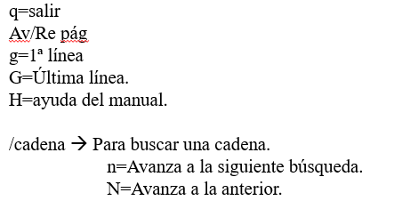
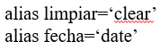

# 02. Primeros Comandos, Ayuda y Gestión de Sesión

Este módulo cubre los conceptos iniciales para desenvolverse en la consola de comandos de Linux: navegación por la ayuda, historial, primeros comandos de sesión, apagado del sistema y gestión de alias.

---

## 1. Acceso a Recursos Compartidos en Red

Para conectarse a un recurso compartido mediante protocolo SMB / CIFS (Samba o Windows Server):

```bash
smb://192.168.2.X/carpeta
```

---

## 2. Sistema de Ayuda en Linux

Linux dispone de manuales y utilidades integradas para consultar la sintaxis y opciones de cualquier herramienta:

| Comando | Descripción | Ejemplo |
| :--- | :--- | :--- |
| `man [comando]` | Abre el manual completo de un comando o archivo de configuración. | `man 5 passwd` *(Muestra la ayuda del archivo /etc/passwd en la sección 5 del manual)* |
| `whatis [comando]` | Muestra una descripción de una sola línea del comando. | `whatis ls` |
| `apropos [palabra]` | Busca y lista todos los comandos cuya descripción contenga la palabra clave. | `apropos network` |

### Navegación y Atajos en las páginas del Manual (`man`)



* **`q`**: Salir del manual.
* **`AvPág` / `RePág`**: Avanzar o retroceder una página entera.
* **`g`**: Ir a la primera línea del manual.
* **`G`**: Ir a la última línea del manual.
* **`h`**: Mostrar la ayuda de navegación dentro del manual.
* **`/cadena`**: Buscar una cadena de texto dentro de la página.
  * **`n`**: Avanzar a la siguiente coincidencia.
  * **`N`**: Retroceder a la coincidencia anterior.

---

## 3. Historial de Comandos

El shell almacena el registro de comandos ejecutados en la sesión:

| Comando / Atajo | Acción |
| :--- | :--- |
| `history` | Muestra el listado numerado de comandos ejecutados. |
| `!Nº` | Ejecuta directamente el comando ubicado en la posición `Nº` del historial. |
| `Ctrl + r` | Búsqueda interactiva hacia atrás. Pulsar nuevamente `Ctrl + r` para saltar a la siguiente coincidencia. |
| `history -c` | Limpia el historial de comandos de la sesión actual del terminal. |

---

## 4. Primeros Comandos del Terminal

Comandos básicos de inspección del entorno de trabajo y control de flujo:

| Comando | Función |
| :--- | :--- |
| `clear` | Limpia el texto visible en la pantalla del terminal (equivalente a `Ctrl + l`). |
| `pwd` | (*Print Working Directory*) Muestra la ruta absoluta del directorio actual. |
| `whoami` | Muestra el nombre del usuario con el que se está trabajando. |
| `tty` | Imprime el nombre del archivo del terminal o pseudoterminal actual (ej. `/dev/pts/0`). |
| `who` | Muestra qué usuarios tienen una sesión abierta en el sistema. |
| `last` | Muestra el histórico de los últimos inicios y cierres de sesión de usuarios. |
| `comando1 ; comando2` | Ejecuta el primer comando y a continuación el segundo, sin importar si el primero falla o no. |
| `comando1 && comando2` | Operador lógico AND: ejecuta `comando2` solo si `comando1` finaliza correctamente (código de retorno 0). |

---

## 5. Cierre de Sesión y Bloqueo

* **`exit`** o **`Ctrl + d`**: Cierra la sesión activa en el terminal o intérprete actual.
* **`Super / Windows + L`**: Bloquea la sesión gráfica actual inmediatamente.

---

## 6. Control de Energía: Apagado y Reinicio

> [!WARNING]
> Estos comandos requieren privilegios de administración (`sudo` o usuario `root`, indicado habitualmente con el símbolo `#`).

| Comando | Acción | Ejemplos de Uso |
| :--- | :--- | :--- |
| `# shutdown` | Programa el apagado o reinicio de la máquina. | Ver ejemplos detallados a continuación. |
| `# poweroff` | Apaga y corta la alimentación del equipo inmediatamente. | `# poweroff -f` *(fuerza el apagado inmediato)* |
| `# reboot` | Reinicia el sistema operativo de inmediato. | `# reboot` |

### Opciones avanzadas de `shutdown`


```bash
# Reiniciar de inmediato:
shutdown -r now

# Apagar de inmediato:
shutdown -h now

# Apagar transcurrido un tiempo determinado en minutos:
shutdown -h +10

# Apagar a una hora específica:
shutdown -h 23:30

# Apagar con aviso a los usuarios conectados:
shutdown -h +15 "El sistema se va a apagar. Guarde sus cambios."

# Cancelar un apagado programado:
shutdown -c
```


---

## 7. Creación y Gestión de Alias

Los alias permiten definir atajos o nombres abreviados para comandos largos o de uso frecuente:

| Acción | Sintaxis / Comando |
| :--- | :--- |
| **Ver alias activos** | `alias` |
| **Crear alias temporal** | `alias Nombre_alias='comando'` |
| **Eliminar alias temporal** | `unalias Nombre_alias` |
| **Persistencia** | Se deben añadir dentro del archivo `~/.bashrc` del usuario para que se carguen en cada nueva sesión. |



*Ejemplos habituales:*
```bash
alias limpiar='clear'
alias fecha='date'
alias ll='ls -lha'
```

---

## 8. Editores de Texto en Consola

* **`nano`**: Editor de texto rápido e intuitivo para terminal.
  * Archivo de configuración global: `/etc/nanorc`.
* **`vi` / `vim`**: Editor modal potente estándar en sistemas UNIX/Linux.

---

## 📌 Enlaces Relacionados
- [Módulo anterior: 01. Archivos Importantes y Sistema](./01-archivos-importantes-y-sistema.md)
- [Ir al índice principal (README.md)](./README.md)
- [Módulo siguiente: 03. Ficheros y Directorios](./03-ficheros-y-directorios.md)
