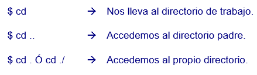
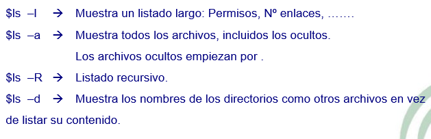

# 03. Gestión de Ficheros y Directorios

En este módulo se detallan las herramientas esenciales para examinar, navegar, manipular, enlazar y localizar archivos y carpetas en el sistema de archivos de Linux.

---

## 1. Visualización y Análisis de Ficheros de Texto

| Comando | Descripción | Ejemplo de Uso |
| :--- | :--- | :--- |
| `cat [fichero]` | Muestra todo el contenido del archivo en la salida estándar. | `cat -n prueba`<br>*(Muestra el archivo numerando todas las líneas)* |
| `head [fichero]` | Visualiza las primeras 10 líneas de un fichero por defecto. | `head -n 5 prueba`<br>*(Muestra solo las 5 primeras líneas)* |
| `tail [fichero]` | Visualiza las últimas 10 líneas de un fichero por defecto. | `tail -n 5 prueba`<br>*(Muestra las últimas 5 líneas)* |
| `tail -f [fichero]` | Mantiene abierto el archivo mostrando nuevas líneas añadidas en tiempo real (ideal para logs). | `tail -f /var/log/syslog` |
| `diff [fichero1] [fichero2]` | Compara y resalta las diferencias entre dos ficheros. | `diff -y fichero1 fichero2`<br>*(Muestra la comparativa en dos columnas paralelas)* |
| `wc [fichero]` | Cuenta el número de líneas, palabras y bytes/caracteres de un fichero. | Contar solo líneas:<br>`wc -l archivo.txt` |

---

## 2. Navegación por el Árbol de Directorios (`cd`)

El comando `cd` (*Change Directory*) permite desplazarse entre las carpetas del sistema.



```bash
cd         # Lleva directamente al directorio personal del usuario ($HOME)
cd ..      # Sube un nivel hacia el directorio padre
cd .       # Hace referencia al propio directorio actual (o cd ./)
cd -       # Regresa al directorio de trabajo inmediatamente anterior
cd /ruta   # Navega a una ruta absoluta
```

---

## 3. Listado y Operaciones Básicas

### Listar contenido (`ls`)



* **`ls -l`**: Muestra un listado en formato largo (permisos, enlaces, propietario, grupo, tamaño y fecha).
* **`ls -a`**: Muestra todos los archivos y carpetas, incluyendo los ocultos (aquellos cuyo nombre empieza por un punto `.`).
* **`ls -R`**: Listado recursivo, recorriendo todos los subdirectorios.
* **`ls -d`**: Muestra las propiedades de los propios directorios en lugar de listar su contenido interno.

### Creación, Copia, Movimiento y Eliminación

| Operación | Comando | Detalle |
| :--- | :--- | :--- |
| **Crear directorio** | `mkdir nombre_dir` | Crea una carpeta vacía. |
| **Crear en cascada** | `mkdir -p ruta/a/subdirectorio` | Crea carpetas intermedias automáticamente si no existen. |
| **Copiar ficheros** | `cp origen destino` | Copia uno o varios archivos a la ruta destino. |
| **Copiar directorios** | `cp -r origen destino` | Copia un directorio completo y todo su contenido recursivamente. |
| **Mover / Renombrar** | `mv origen destino` | Cambia el nombre de un elemento o lo traslada de ubicación. |
| **Borrar directorio/fichero** | `rm -r directorio` | Elimina directorios con su contenido recursivamente. |
| **Borrado forzado** | `rm -rf directorio` | Fuerza el borrado sin solicitar confirmación. |

---

## 4. Inodos y Enlaces (Hard Links y Soft Links)

Cada elemento en el sistema de archivos de Linux está representado por una estructura interna llamada **inodo** (*inode*), que almacena sus metadatos (tamaño, permisos, fechas, punteros a bloques de datos):

```bash
ls -i nombre_archivo   # Muestra el número de inodo asociado al archivo
```

| Tipo de Enlace | Comando | Características |
| :--- | :--- | :--- |
| **Enlace Duro (Hard Link)** | `ln origen destino` | Crea una nueva entrada de directorio que apunta al mismo inodo y bloques de datos. Si se borra el archivo original, el dato sigue existiendo a través del enlace duro. No puede cruzar distintos sistemas de archivos ni enlazar directorios. |
| **Enlace Simbólico (Soft/Symlink)** | `ln -s origen destino` | Crea un acceso directo que apunta a la ruta del archivo original. Si el original se borra o se mueve, el enlace simbólico queda roto (*huérfano*). Puede cruzar sistemas de archivos y apuntar a carpetas. |

---

## 5. Búsqueda Avanzada de Ficheros (`find`)

La herramienta `find` recorre el árbol de directorios buscando archivos que cumplan criterios específicos y permite ejecutar acciones sobre ellos:

$$\text{find [ruta] [criterio] [acción] ;}$$

```bash
find [ruta] [criterios] [acción] \;
```


### Ejemplo Práctico
```bash
# Busca en todo el sistema los ficheros cuyo nombre empiece por "joe" (ignorando mayúsculas) 
# y los copia a la carpeta /home/heidi:
find / -iname "joe*" -exec cp {} /home/heidi \;
```

*Donde:*
* `-iname`: Búsqueda por nombre que no distingue mayúsculas y minúsculas (*case-insensitive*).
* `-exec`: Ejecuta un comando externo sobre cada resultado.
* `{}`: Marcador de posición que se sustituye por la ruta del archivo encontrado.
* `\;`: Indica el final de la instrucción ejecutada por `-exec`.

---

## 📌 Enlaces Relacionados
- [Módulo anterior: 02. Primeros Comandos y Ayuda](./02-primeros-comandos-y-ayuda.md)
- [Ir al índice principal (README.md)](./README.md)
- [Módulo siguiente: 04. Empaquetado y Compresión](./04-empaquetado-y-compresion.md)
