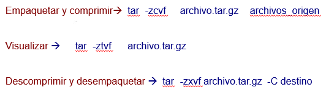
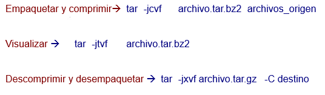

# 04. Empaquetado y Compresión de Archivos

En entornos Linux se distingue habitualmente entre **empaquetar** (unir múltiples ficheros y directorios en un solo archivo contenedor sin reducir tamaño) y **comprimir** (aplicar un algoritmo matemático como DEFLATE, gzip o bzip2 para reducir el volumen de datos).

A continuación se resumen los tres formatos más comunes en administración de sistemas:

---

## 1. Formato ZIP (`zip` / `unzip`)

El formato `.zip` es el estándar multiplataforma más habitual.

| Operación | Comando | Descripción |
| :--- | :--- | :--- |
| **Comprimir** | `zip archivo.zip ficheros_a_comprimir` | Crea el archivo comprimido con los ficheros indicados. Para carpetas usar `zip -r`. |
| **Visualizar** | `unzip -v archivo.zip` | Lista el contenido del archivo sin descomprimirlo en disco. |
| **Descomprimir** | `unzip archivo.zip -d Directorio_destino` | Extrae todo el contenido dentro del directorio destino indicado. |

---

## 2. Formato TAR con compresión GZIP (`.tar.gz` o `.tgz`)

Utiliza el algoritmo de compresión `gzip` (rápido y con un equilibrio excelente entre velocidad y tasa de compresión).

| Operación | Comando | Explicación de Flags |
| :--- | :--- | :--- |
| **Empaquetar y comprimir** | `tar -zcvf archivo.tar.gz archivos_origen` | `-z` (gzip), `-c` (crear), `-v` (verbose/detallado), `-f` (archivo). |
| **Visualizar contenido** | `tar -ztvf archivo.tar.gz` | `-t` (listar contenido sin extraer). |
| **Descomprimir y desempaquetar** | `tar -zxvf archivo.tar.gz -C destino` | `-x` (extraer), `-C` (indica el directorio donde depositar los archivos). |

---

## 3. Formato TAR con compresión BZIP2 (`.tar.bz2` o `.tbz2`)

Utiliza el algoritmo `bzip2`, que ofrece un ratio de compresión más alto a costa de un mayor consumo de tiempo de CPU.

| Operación | Comando | Explicación de Flags |
| :--- | :--- | :--- |
| **Empaquetar y comprimir** | `tar -jcvf archivo.tar.bz2 archivos_origen` | `-j` (bzip2), `-c` (crear), `-v` (detallado), `-f` (archivo). |
| **Visualizar contenido** | `tar -jtvf archivo.tar.bz2` | `-t` (listar sin extraer). |
| **Descomprimir y desempaquetar** | `tar -jxvf archivo.tar.bz2 -C destino` | `-x` (extraer), `-C` (directorio de destino). |

---

## 4. Tabla Mnemotécnica de Opciones de `tar`

| Opción | Significado | Función |
| :---: | :--- | :--- |
| **`-c`** | *Create* | Crea un nuevo archivo empaquetado. |
| **`-x`** | *eXtract* | Extrae los ficheros de un archivo empaquetado. |
| **`-t`** | *Table of contents* | Lista el contenido del archivo sin extraerlo. |
| **`-v`** | *Verbose* | Muestra en pantalla el progreso y los nombres de los archivos procesados. |
| **`-f`** | *File* | Especifica el nombre del archivo `.tar` (debe ir justo antes del nombre del archivo). |
| **`-z`** | *Gzip* | Procesa el archivo con compresión `gzip` (`.tar.gz`). |
| **`-j`** | *bzip2* | Procesa el archivo con compresión `bzip2` (`.tar.bz2`). |
| **`-C`** | *Change dir* | Cambia al directorio especificado antes de realizar la extracción. |

---

## 📌 Enlaces Relacionados
- [Módulo anterior: 03. Ficheros y Directorios](./03-ficheros-y-directorios.md)
- [Ir al índice principal (README.md)](./README.md)
- [Módulo siguiente: 05. Filtros y Procesamiento de Texto](./05-filtros-y-procesamiento-texto.md)
