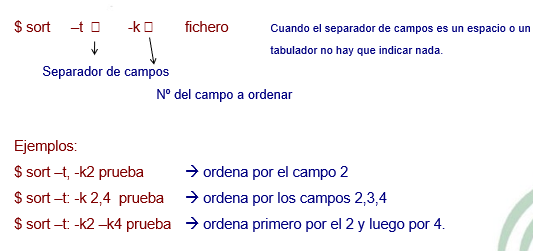
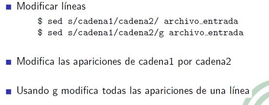
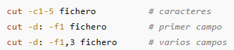
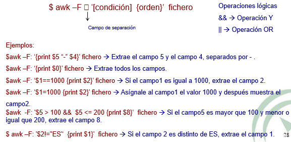
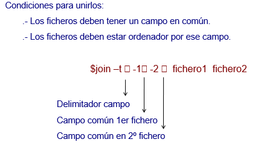

# 05. Filtros y Procesamiento de Flujos de Texto

La potencia de la línea de comandos en Linux radica en su capacidad de transformar y filtrar datos mediante tuberías (*pipes* `|`). En este módulo se analizan las utilidades más importantes: `sort`, `tr`, `sed`, `grep`, `cut`, `paste`, `awk` y `join`.

---

## 1. Ordenación de Datos (`sort`)

El comando `sort` ordena líneas de ficheros de texto alfanuméricamente según los campos que se indiquen.



### Sintaxis
```bash
sort -t [separador] -k [campo] fichero
```

* **`-t`**: Define el carácter separador de campos (delimitador). Si es un espacio o un tabulador, no hace falta indicarlo.
* **`-k`**: Especifica el número de campo o columna a ordenar.

### Ejemplos Prácticos
```bash
# Ordenar por el campo 2 usando como delimitador la coma (,):
sort -t, -k2 prueba

# Ordenar evaluando el rango de campos del 2 al 4 usando dos puntos (:):
sort -t: -k 2,4 prueba

# Ordenar primero por el campo 2 y, en caso de empate, por el campo 4:
sort -t: -k2 -k4 prueba
```

---

## 2. Transformación y Eliminación de Caracteres (`tr`)

La herramienta `tr` (*translate*) lee de la entrada estándar y sustituye, reduce o elimina conjuntos de caracteres específicos.


### Sintaxis
```bash
tr [opciones] conj1 conj2
comando | tr [opciones] conj1 conj2
```

### Opciones Principales
* **`-s`** (*squeeze*): Sustituye una secuencia de caracteres repetidos consecutivos por una sola ocurrencia (por ejemplo, múltiples espacios por uno solo).
* **`-c`** (*complement*): Aplica la operación a todos los caracteres que **no** pertenezcan al conjunto indicado (`conj1`).
* **`-d`** (*delete*): Elimina todos los caracteres que coincidan con los indicados en el conjunto.

---

## 3. Editor de Flujo de Texto (`sed`)

`sed` (*Stream Editor*) permite realizar transformaciones complejas en flujos de texto, especialmente sustituciones mediante expresiones regulares.



```bash
# Modificar la primera ocurrencia de "cadena1" por "cadena2" en cada línea:
sed s/cadena1/cadena2/ archivo_entrada

# Modificar todas las ocurrencias globales (flag 'g') en cada línea:
sed s/cadena1/cadena2/g archivo_entrada
```

---

## 4. Búsqueda de Patrones (`grep`)

`grep` examina archivos o flujos en busca de líneas que coincidan con un patrón o expresión regular.


### Sintaxis
```bash
grep [opciones] patrón fichero
cat fichero | grep [opciones] patrón
```

### Modificadores Fundamentales
| Opción | Función |
| :---: | :--- |
| **`-i`** | Ignora mayúsculas y minúsculas (*case-insensitive*). |
| **`-v`** | Invierte la selección: devuelve las líneas que **no** coinciden con el patrón. |
| **`-c`** | Devuelve solo el número total de líneas coincidentes encontradas. |
| **`-r`** / **`-R`** | Búsqueda recursiva en todos los subdirectorios. |
| **`-w`** | Selecciona únicamente las líneas donde el patrón aparece como una **palabra completa**. |

---

## 5. Extracción de Columnas (`cut`)

`cut` divide cada línea de un archivo y extrae secciones o campos específicos.



```bash
cut -c1-5 fichero        # Extrae los caracteres del 1 al 5
cut -d: -f1 fichero      # Extrae el primer campo usando ":" como delimitador
cut -d: -f1,3 fichero    # Extrae el primer y tercer campo
```

---

## 6. Combinación de Ficheros Línea por Línea (`paste`)

A diferencia de `cat` (que concatena archivos de arriba a abajo), `paste` une archivos en paralelo horizontalmente, combinando sus líneas respectivas:

```bash
paste -d: fichero1 fichero2
```
* **`-d:`**: Especifica el carácter delimitador (en este caso `:`) para separar los contenidos de cada archivo.

---

## 7. Procesador de Patrones y Reportes (`awk`)

`awk` es un lenguaje de procesamiento de texto completo ideal para filtrar y procesar tablas y registros estructurados.



### Sintaxis
```bash
awk -F [separador] '[condición] {orden}' fichero
```

* **`-F`**: Define el delimitador de campos (por ejemplo `-F:`).
* **`$0`**: Representa la línea completa.
* **`$1`, `$2`, ...**: Representan el primer campo, segundo campo, etc.
* **Operadores lógicos**: `&&` (operación lógica Y / AND), `||` (operación lógica O / OR).

### Ejemplos Prácticos
```bash
# Extrae el campo 5 y el campo 4 concatenados con un guion:
awk -F: '{print $5 "-" $4}' fichero

# Muestra la línea completa (todos los campos):
awk -F: '{print $0}' fichero

# Si el campo 1 es exactamente igual a 1000, muestra el campo 2:
awk -F: '$1==1000 {print $2}' fichero

# Asigna el valor 1000 al campo 1 y muestra el campo 2:
awk -F: '$1=1000 {print $2}' fichero

# Condición combinada: si el campo 5 está en el rango (100, 200], extrae el campo 8:
awk -F: '$5 > 100 && $5 <= 200 {print $8}' fichero

# Si el campo 2 es diferente de "ES", extrae el campo 1:
awk -F: '$2!="ES" {print $1}' fichero
```

---

## 8. Unión de Archivos por Clave Relacional (`join`)

El comando `join` une las líneas de dos archivos basándose en un campo común (similar a una operación *INNER JOIN* de bases de datos relacionales).

> [!IMPORTANT]
> **Condiciones indispensables para poder utilizar `join`:**
> 1. Ambos ficheros deben tener un campo clave en común.
> 2. Ambos ficheros deben haber sido ordenados previamente (`sort`) por dicho campo clave.



### Sintaxis
```bash
join -t [separador] -1 [campo_fichero1] -2 [campo_fichero2] fichero1 fichero2
```

* **`-t`**: Carácter delimitador de campos.
* **`-1`**: Número de la columna común en el primer archivo.
* **`-2`**: Número de la columna común en el segundo archivo.

---

## 📌 Enlaces Relacionados
- [Módulo anterior: 04. Empaquetado y Compresión](./04-empaquetado-y-compresion.md)
- [Ir al índice principal (README.md)](./README.md)
- [Módulo siguiente: 06. Permisos y Seguridad](./06-permisos-y-seguridad.md)
