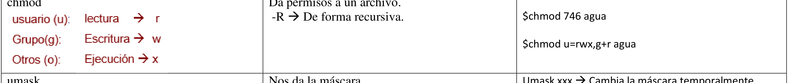

# 06. Permisos, Usuarios y Seguridad de Ficheros

La seguridad en Linux se basa en un modelo discrecional de usuarios, grupos y permisos sobre cada inodo del sistema de archivos.

---

## 1. Identificación de Usuarios y Grupos (`id`)

Para consultar el identificador numérico de usuario (*UID*), el identificador numérico de grupo principal (*GID*) y los grupos secundarios a los que pertenece una cuenta:

```bash
id          # Muestra la identidad del usuario actual
id usuario  # Muestra la identidad del usuario indicado
```

---

## 2. Permisos Tradicionales de Linux (`chmod`)

Cada archivo y directorio cuenta con tres conjuntos de permisos aplicados a tres categorías de usuarios:



### Categorías de Usuarios y Modos de Acceso

| Categoría | Símbolo | Tipo de Permiso | Modo Simbólico | Valor Octal |
| :--- | :---: | :--- | :---: | :---: |
| **Usuario / Propietario** | `u` | **Lectura** | `r` | **4** |
| **Grupo** | `g` | **Escritura** | `w` | **2** |
| **Otros** | `o` | **Ejecución** | `x` | **1** |
| *Todos (All)* | `a` | *Sin acceso* | `-` | **0** |

### Métodos de Asignación

#### A) Notación Octal o Numérica
Se calcula sumando los valores de cada terna ($r=4, w=2, x=1$):
* $7 = 4 + 2 + 1$ (`rwx`: lectura, escritura y ejecución)
* $6 = 4 + 2$ (`rw-`: lectura y escritura)
* $5 = 4 + 1$ (`r-x`: lectura y ejecución)
* $4 = 4$ (`r--`: solo lectura)
* $0 = 0$ (`---`: sin ningún permiso)

```bash
# Permisos: u=rwx (7), g=r-- (4), o=rw- (6):
chmod 746 agua

# Aplicar permisos recursivamente a una carpeta y su contenido:
chmod -R 755 /var/www/sitio
```

#### B) Notación Simbólica
```bash
# Asignar lectura, escritura y ejecución al dueño, y lectura al grupo:
chmod u=rwx,g+r agua

# Quitar permisos de escritura a otros:
chmod o-w archivo.txt

# Añadir ejecución a todos:
chmod +x script.sh
```

---

## 3. Máscara de Permisos por Defecto (`umask`)

La máscara determina qué permisos se le **restan** por omisión a los archivos y carpetas recién creados.

* **Permisos base de creación**:
  * Archivos: `666` (`rw-rw-rw-`)
  * Directorios: `777` (`rwxrwxrwx`)
* Con una `umask 022`:
  * Archivos creados: `666 - 022 = 644` (`rw-r--r--`)
  * Carpetas creadas: `777 - 022 = 755` (`rwxr-xr-x`)

```bash
umask        # Consulta la máscara actual
umask 027    # Cambia la máscara temporalmente en la sesión actual
```

> [!NOTE]
> Para hacer permanente el cambio de máscara, se debe declarar la directiva `umask xxx` dentro del archivo `~/.bashrc` o `/etc/profile`.

---

## 4. Cambio de Propietario y Grupo (`chown`)

Permite transferir la titularidad de un archivo o carpeta a otro usuario y/o grupo:

```bash
chown [opciones] usuario_nuevo[:grupo_nuevo] fichero
```

### Ejemplos Prácticos
```bash
# Cambiar propietario y grupo recursivamente a todos los elementos del directorio:
chown -R www-data:www-data /var/www/html

# Cambiar únicamente el usuario propietario:
chown heidi informe.pdf

# Cambiar únicamente el grupo asignado (también se puede usar chgrp):
chown :profesores notas.txt
```

---

## 5. Permisos Especiales: *Sticky Bit*

El **Sticky Bit** aplicado a un directorio impide que un usuario pueda borrar o renombrar archivos pertenecientes a otros usuarios dentro de dicha carpeta, aunque tenga permisos de escritura sobre el directorio contenedor (solo el propietario del archivo o el superusuario `root` pueden borrarlo).

Es el mecanismo de seguridad utilizado en carpetas compartidas comunes como `/tmp`.

```bash
# Activar el sticky bit en modo simbólico:
chmod o+t prueba

# Activar el sticky bit en modo octal (prefijo 1):
chmod 1777 /directorio_compartido
```

*En un listado largo (`ls -l`), se representa con una letra `t` en la posición de ejecución de "otros" (ej. `drwxrwxrwt`).*

---

## 📌 Enlaces Relacionados
- [Módulo anterior: 05. Filtros y Procesamiento de Texto](./05-filtros-y-procesamiento-texto.md)
- [Ir al índice principal (README.md)](./README.md)
- [Módulo siguiente: 07. Gestión de Paquetes y SSH](./07-gestion-paquetes-y-ssh.md)
