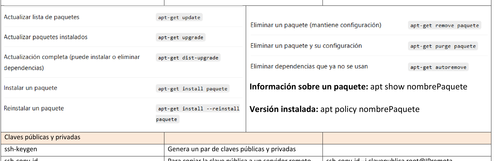

# 07. Gestión de Paquetes (APT) y Administración Remota (SSH / SCP)

Este módulo resume los métodos para gestionar aplicaciones mediante el sistema de paquetes APT en distribuciones Debian y Ubuntu, la configuración de la variable de entorno `PATH`, y la autenticación segura sin contraseña y transferencia de archivos mediante SSH.

---

## 1. La Variable de Entorno `PATH`

La variable `PATH` almacena una lista ordenada de directorios (separados por `:`) donde la shell busca los archivos ejecutables al teclear un comando sin indicar su ruta completa.

```bash
# Consultar el contenido actual de PATH:
echo $PATH

# Añadir un nuevo directorio al final de PATH:
export PATH=$PATH:/nueva/ruta/bin

# Añadir un nuevo directorio al principio de PATH (máxima prioridad de ejecución):
export PATH=/nueva/ruta/bin:$PATH
```

> [!NOTE]
> Para hacer que esta modificación sea permanente para tu usuario, agrega la línea `export PATH=...` al final de tu archivo `~/.bashrc`.

---

## 2. Gestión de Paquetes con APT (`apt` / `apt-get`)

En distribuciones basadas en Debian (Debian, Ubuntu, Linux Mint), el gestor de paquetes de alto nivel es APT.



### Operaciones Fundamentales

| Operación | Comando | Descripción |
| :--- | :--- | :--- |
| **Actualizar índices** | `sudo apt-get update` | Descarga las listas actualizadas de paquetes desde los repositorios (`/etc/apt/sources.list`). |
| **Actualizar paquetes** | `sudo apt-get upgrade` | Actualiza todos los paquetes instalados a la versión más reciente sin desinstalar paquetes. |
| **Actualización avanzada** | `sudo apt-get dist-upgrade` | Actualización inteligente que resuelve dependencias complejas pudiendo instalar o quitar paquetes si es necesario. |
| **Instalar paquete** | `sudo apt-get install paquete` | Descarga e instala el paquete junto a todas sus dependencias. |
| **Reinstalar paquete** | `sudo apt-get install --reinstall paquete` | Repara o vuelve a instalar un paquete dañado. |
| **Eliminar conservando conf.** | `sudo apt-get remove paquete` | Desinstala los binarios del paquete pero conserva sus archivos de configuración. |
| **Eliminación completa (Purga)** | `sudo apt-get purge paquete` | Borra el paquete y todos sus archivos de configuración asociados. |
| **Limpieza de dependencias** | `sudo apt-get autoremove` | Desinstala paquetes huérfanos que se instalaron automáticamente como dependencias y ya no se necesitan. |
| **Información del paquete** | `apt show nombrePaquete` | Muestra la descripción detallada, tamaño, dependencias y versión disponible. |
| **Política de versiones** | `apt policy nombrePaquete` | Indica la versión instalada actualmente y la prioridad/origen de los repositorios candidatos. |

---

## 3. Autenticación Asimétrica con SSH

SSH (*Secure Shell*) permite conectarse de forma cifrada a servidores remotos. La autenticación basada en claves públicas y privadas elimina la necesidad de teclear contraseñas y es mucho más segura.

### Generación y Despliegue de Claves

1. **Generar el par de claves en el cliente:**
   ```bash
   ssh-keygen -t ed25519    # Clave moderna Ed25519 (recomendada)
   # O alternativamente:
   ssh-keygen -t rsa -b 4096
   ```
   *Esto genera dos ficheros en `~/.ssh/`: la clave privada (`id_ed25519`, **nunca debe compartirse**) y la clave pública (`id_ed25519.pub`).*

2. **Copiar la clave pública al servidor remoto:**
   ```bash
   ssh-copy-id -i ~/.ssh/id_ed25519.pub usuario@192.168.1.50
   ```

### Archivos de Seguridad SSH Clave

| Ubicación | Archivo | Función |
| :--- | :--- | :--- |
| **Cliente** | `~/.ssh/known_hosts` | Almacena las huellas digitales (*fingerprints*) de los servidores a los que nos hemos conectado previamente, protegiendo contra ataques de suplantación (*Man-in-the-Middle*). |
| **Servidor** | `~/.ssh/authorized_keys` | Almacena la lista de claves públicas autorizadas para iniciar sesión con ese usuario sin solicitar clave de acceso. |

---

## 4. Transferencia Segura de Archivos (`scp`)

`scp` (*Secure Copy Protocol*) permite copiar archivos entre la máquina local y un host remoto a través de un túnel SSH cifrado.

### Sintaxis
```bash
scp [opciones] origen destino
```

* **`-r`**: Copia directorios completos de forma recursiva.
* **`-P [puerto]`**: Permite especificar un puerto SSH alternativo si no es el estándar 22.

### Ejemplos Prácticos
```bash
# Copiar un archivo local al servidor remoto:
scp fichero.txt usuario@servidor:/ruta/destino/

# Copiar un directorio completo recursivamente:
scp -r /home/usuario/proyecto usuario@servidor:/var/www/

# Descargar un archivo desde el servidor a la máquina local:
scp usuario@servidor:/var/log/syslog ./syslog_backup.log
```

---

## 📌 Enlaces Relacionados
- [Módulo anterior: 06. Permisos y Seguridad](./06-permisos-y-seguridad.md)
- [Ir al índice principal (README.md)](./README.md)
- [Módulo siguiente: 08. Discos, Particiones y Montaje](./08-discos-particiones-y-montaje.md)
