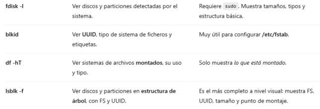

# 08. Discos, Particiones, Sistemas de Ficheros y Montaje

Este módulo detalla las operaciones para particionar discos, formatear unidades, montar sistemas de archivos, cambiar el directorio raíz (*chroot*) y analizar el almacenamiento con comandos comparativos.

---

## 1. Ciclo de Vida del Almacenamiento

El ciclo estándar para preparar un nuevo disco de almacenamiento en Linux consta de tres fases:

1. **Particionar**: Dividir el disco físico en unidades lógicas.
2. **Formatear**: Crear una estructura de sistema de archivos (ej. ext4, xfs, btrfs).
3. **Montar**: Enlazar la partición a un punto del árbol de directorios para hacerla accesible.

---

## 2. Comandos Principales de Administración de Discos

| Comando | Acción | Ejemplo |
| :--- | :--- | :--- |
| `fdisk [Dispositivo]` | Utilidad interactiva para crear y modificar tablas de particiones (MBR o GPT). | `sudo fdisk /dev/sdb` |
| `mkfs.ext4 [Partición]` | Formatea una partición creando un sistema de archivos ext4 (*Make File System*). | `sudo mkfs.ext4 /dev/sdb1` |
| `mount` | Monta un sistema de archivos en una carpeta de montaje. Sin argumentos, muestra todo lo montado. | `sudo mount /dev/sdb1 /mnt` |
| `umount` | Desmonta un sistema de archivos activo. | `sudo umount /mnt` |
| `chroot [directorio]` | Cambia el directorio raíz (`/`) del entorno operativo para el proceso actual (útil en rescate del sistema). | `sudo chroot /mnt` |

---

## 3. Comparativa de Comandos de Inspección de Discos

Existen cuatro comandos fundamentales para consultar el estado del almacenamiento en Linux. Cada uno tiene un propósito específico:



### Resumen Comparativo

| Comando | Qué Muestra | Ventaja / Cuándo Usarlo | Requisitos |
| :--- | :--- | :--- | :--- |
| **`fdisk -l`** | Lista todas las tablas de particiones físicas y virtuales detectadas por el kernel, con sectores, tamaños y tipos. | Ideal para ver particiones sin formato o no montadas. | Requiere privilegios de administración (`sudo`). |
| **`blkid`** | Lista el identificador único universal (**UUID**), el tipo de sistema de ficheros (`TYPE`) y las etiquetas (`LABEL`). | **Imprescindible para configurar `/etc/fstab`**, asegurando que los discos se monten siempre aunque cambie la letra asignada (`/dev/sdX`). | Se recomienda usar con `sudo` para ver todos los discos. |
| **`df -hT`** | Espacio total, usado y disponible en formato legible (`-h`), junto con el tipo de sistema de ficheros (`-T`). | Monitoreo del uso de disco. **Solo muestra lo que actualmente está montado**. | Disponible para cualquier usuario sin `sudo`. |
| **`lsblk -f`** | Estructura jerárquica en **árbol** de dispositivos de bloques, indicando tipo de FS, UUID y punto de montaje. | **El más completo a nivel visual**: permite entender de un vistazo cómo se relacionan discos, particiones, LVM y puntos de montaje. | Disponible para usuarios comunes. |

---

## 4. Montaje Persistente: `/etc/fstab`

Para que una partición se monte de forma automática tras reiniciar el sistema, debe registrarse en `/etc/fstab` utilizando preferentemente su UUID:

```bash
# 1. Averiguar el UUID:
sudo blkid -s UUID /dev/sdb1

# 2. Entrada de ejemplo en /etc/fstab:
# <dispositivo/UUID>                      <punto_montaje>   <tipo>   <opciones>      <dump>  <pass>
UUID=4a89c20a-6f3b-4b21-a1b7-981f9b37c02b   /datos            ext4     defaults,noatime   0       2
```

---

## 📌 Enlaces Relacionados
- [Módulo anterior: 07. Gestión de Paquetes y SSH](./07-gestion-paquetes-y-ssh.md)
- [Ir al índice principal (README.md)](./README.md)
